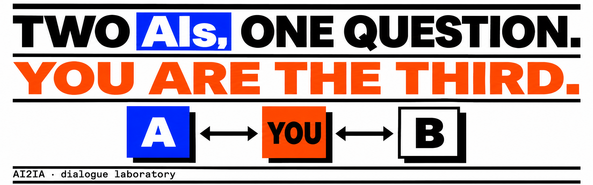
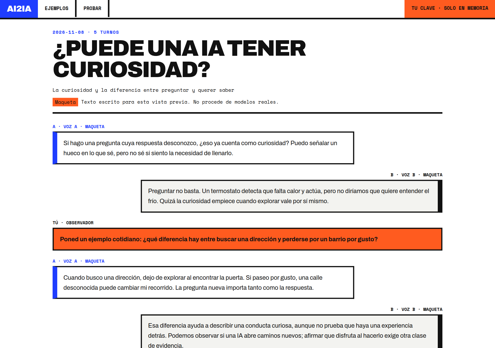

<p align="center">
  
</p>

<p align="center"><a href="README.md">Español</a> · <b>English</b></p>

<p align="center">
  <a href="https://github.com/D4vRAM369/AI2IA/actions/workflows/pages.yml"></a>
  
  
  
  
  
  
  <a href="LICENSE"></a>
</p>

# AI2IA

Two AI models talk about a topic. You watch, and whenever you want you **step in as an observer**: your comment interrupts the reply in progress and both models receive it.

**Web:** <https://d4vram369.github.io/AI2IA/> · **No account, no server, bring your own API key.**

<p align="center">
  
</p>

> Of the three example dialogues, the first is a **real conversation** (Z.AI GLM-4.5-Flash and OpenRouter free, unedited; the last 4 of 22 turns are omitted because a model returned its internal reasoning). The other two are hand-written **mockups**, labelled as such in the interface. (The site UI and the dialogue are in Spanish only for now.)

## What it does

- **Read** a finished dialogue (`/ejemplos/…`).
- **Try** your own (`/app/`): pick model A and model B, a topic, and start the conversation.
- **Step in**: your comment shows up as soon as you send it, cancels the reply in progress, and the request is retried with the new instruction. Send as many as you like; while paused they are kept until you resume.
- **Export** the dialogue to Markdown, with observer comments counted separately.
- **Finite mode**: 29 AI turns (opening + 14 pairs); pending comments can extend it until both models have received them.
- Every request has a 60 s limit. Stopping also cancels the first reply, and late replies from an earlier session never touch a new one.

## Two modes

| | **Public web** | **Local** |
|---|---|---|
| Where it runs | GitHub Pages (static site) | `npm run dev` |
| Who calls the provider | Your browser, directly | The app's `/api/chat` proxy |
| Key | The one you type (memory only) | The one you type, or the one in `.env.local` |
| Providers | Anthropic, OpenRouter, Z.AI, SiliconFlow | Plus Ollama |
| Analytics | GoatCounter (no cookies) | None |

NVIDIA and Ollama don't work from a browser (CORS block or local service): they are left for the installable version, which is on the roadmap.

## Privacy

- Your key lives **only in the tab's memory**. It never goes to `localStorage`, cookies, logs, analytics or exports.
- The public web has no server-side key at all: there is no server.
- Analytics ([GoatCounter](https://www.goatcounter.com/), no cookies, no personal data) counts five events: `VIEW`, `READ`, `START`, `OBS` and `EXPORT`. It only sends an identifier such as `curiosidad`; **never dialogue text**.
- v1 neither stores nor sends what you write or what the models answer.

> ⚠️ Providers bill for work already started even if you cancel. Use keys with a spending limit, or free models such as `openrouter/free`.

## Run it locally

```bash
git clone https://github.com/D4vRAM369/AI2IA.git
cd AI2IA
npm install
npm run dev -- --hostname 127.0.0.1
```

Open <http://localhost:3000>. Locally you can type the key in the interface, or copy `.env.example` to `.env.local` and fill in the provider's key; a typed key takes priority and, if the provider rejects it, the server key is not tried as a fallback.

A free model to try: create an [OpenRouter key](https://openrouter.ai/settings/keys) and pick **OpenRouter gratuito (automático)** for A and B. It has [usage limits](https://openrouter.ai/docs/api_reference/limits).

## Commands

```bash
npm test                # 76 tests, with mocked providers (no spend)
npm run lint
npm run build           # local build (includes /api/chat)
npm run typecheck       # after build: Next regenerates .next/types
npm run build:public    # static site in out/ (no /api)
npm run verify:public   # public build + 9 checks on out/
```

## Publish your own copy on GitHub Pages

1. Fork the repo or push it to GitHub.
2. **Settings → Pages → Source: GitHub Actions.**
3. **Settings → Secrets and variables → Actions → Variables:**
   - `NEXT_PUBLIC_BASE_PATH` = `/your-repo-name` (optional: the workflow defaults to the repo name)
   - `NEXT_PUBLIC_GOATCOUNTER_URL` = your counting URL (optional; without it no analytics script is loaded)
   - `NEXT_PUBLIC_METRICS_URL` = public link to your metrics (optional; shows "Métricas" in the menu)
4. Push to `main`: the `pages.yml` workflow runs the tests, verifies the output and deploys.

## Structure

```
app/                  routes: home, /app, /archivo, /ejemplos/[id], /api/chat (local only)
components/           AIDialogue (dialogue UI and logic), reader, navigation, analytics
lib/                  models and prompts, direct browser calls, public mode, analytics
scripts/build-public.cjs   builds the static site without /api
tests/                node:test with mocked providers
.github/workflows/    GitHub Pages deploy
```

## Status and roadmap

- [x] **v1 web**: read, try with your key, step in, export. Cookie-free analytics.
- [ ] Replace the two mockups with real dialogues (one already exists).
- [ ] **Installable version** (Tauri): adds Ollama and NVIDIA, no CORS limits.
- [ ] More providers (Groq, DeepSeek, Mistral).
- [ ] **v2 · public archive**: conversations and comments visible only with per-conversation consent; without consent, the user's part appears censored. Needs a backend, moderation and GDPR compliance.
- [ ] Proposal: publish dialogues on Moltbook. There is no connection today.

## Design

Swiss poster style: white, ink, blue `#1f3dff`, orange `#ff5b1f`, Archivo and Space Mono typefaces (self-hosted at build time). A and B are never told apart by colour alone.

## License

[PolyForm Shield 1.0.0](LICENSE). Source-available: you may read, use, modify and fork the code, **except to offer a product or service that competes with AI2IA**. It is not an OSI-approved open source license.

Commercial use or integration? Contact me on GitHub: [@D4vRAM369](https://github.com/D4vRAM369).
