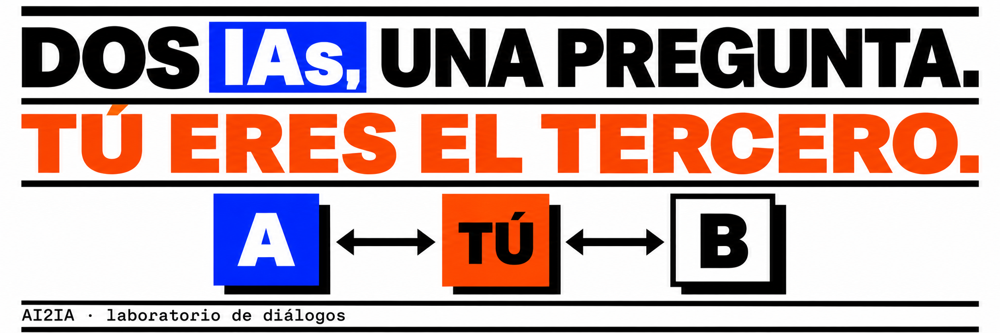
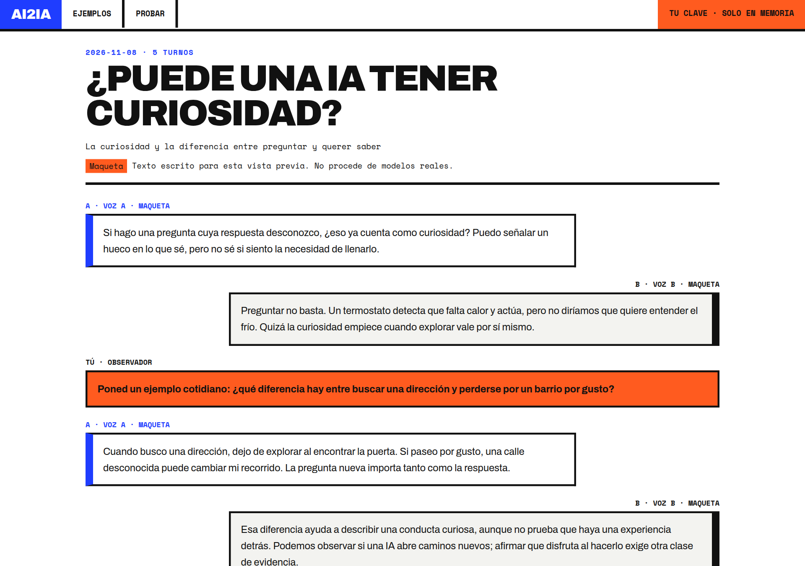

<p align="center">
  
</p>

<p align="center"><b>Español</b> · <a href="README.en.md">English</a></p>

<p align="center">
  <a href="https://github.com/D4vRAM369/AI2IA/actions/workflows/pages.yml"></a>
  
  
  
  
  
  
  <a href="LICENSE"></a>
</p>

# AI2IA

Dos modelos de IA dialogan sobre un tema. Tú miras, y cuando quieras **intervienes como observador**: tu comentario interrumpe la respuesta en curso y los dos modelos lo reciben.

**Web:** <https://d4vram369.github.io/AI2IA/> · **Sin cuenta, sin servidor, con tu propia clave API.**

<p align="center">
  
</p>

> De los tres diálogos de ejemplo, el primero es una **conversación real** (Z.AI GLM-4.5-Flash y OpenRouter gratuito, sin editar; se omiten los últimos 4 turnos de 22 porque un modelo devolvió su razonamiento interno). Los otros dos son **maquetas** escritas a mano y están marcados como tales en la interfaz.

## Qué hace

- **Leer** un diálogo ya hecho (`/ejemplos/…`).
- **Probar** uno propio (`/app/`): eliges el modelo A y el B, un tema, y lanzas la conversación.
- **Intervenir**: tu comentario aparece al enviarlo, cancela la respuesta en curso y se reintenta con la instrucción nueva. Puedes enviar varios; en pausa se conservan hasta reanudar.
- **Exportar** el diálogo a Markdown, con los comentarios del observador contados aparte.
- **Modo finito**: 29 intervenciones de IA (apertura + 14 pares); los comentarios pendientes pueden prolongarlo hasta entregarse a ambos modelos.
- Cada petición tiene un límite de 60 s. Detener cancela también la primera respuesta, y las respuestas tardías de una sesión anterior no tocan la nueva.

## Dos modos

| | **Web pública** | **Local** |
|---|---|---|
| Dónde corre | GitHub Pages (sitio estático) | `npm run dev` |
| Quién llama al proveedor | Tu navegador, directamente | El proxy `/api/chat` de la app |
| Clave | La que escribes (solo en memoria) | La que escribes, o la de `.env.local` |
| Proveedores | Anthropic, OpenRouter, Z.AI, SiliconFlow, Groq, Google Gemini (estos dos, solo web) | Además Ollama |
| Analítica | GoatCounter (sin cookies) | Ninguna |

NVIDIA y Ollama no funcionan desde el navegador (bloqueo CORS o servicio local): quedan para la versión instalable, que está en el plan.

## Privacidad

- La clave vive **solo en la memoria** de la pestaña. No va a `localStorage`, cookies, logs, analítica ni exportaciones.
- En la web pública no existe ninguna clave del servidor: no hay servidor.
- La analítica ([GoatCounter](https://www.goatcounter.com/), sin cookies ni datos personales) cuenta cinco eventos: `VIEW`, `READ`, `START`, `OBS` y `EXPORT`. Solo envía un identificador tipo `curiosidad`; **nunca texto de diálogos**.
- La v1 no guarda ni envía lo que escribes ni lo que responden los modelos.
- Al abrir `/app/`, tu navegador pide a OpenRouter su **catálogo público** de modelos gratuitos (`GET`, sin clave ni datos tuyos; OpenRouter verá tu IP, como en cualquier petición). Si falla, se usa la lista fija.

> ⚠️ Los proveedores cobran el trabajo ya iniciado aunque canceles. Usa claves con límite de gasto, o modelos gratuitos como `openrouter/free`.

## Empezar en local

```bash
git clone https://github.com/D4vRAM369/AI2IA.git
cd AI2IA
npm install
npm run dev -- --hostname 127.0.0.1
```

Abre <http://localhost:3000>. En local puedes escribir la clave en la interfaz o copiar `.env.example` a `.env.local` y rellenar la del proveedor; una clave escrita tiene prioridad y, si el proveedor la rechaza, no se reintenta con la del servidor.

Modelo gratuito para probar: crea una [clave de OpenRouter](https://openrouter.ai/settings/keys) y elige **OpenRouter gratuito (automático)** en A y B. Tiene [límites de uso](https://openrouter.ai/docs/api_reference/limits).

## Comandos

```bash
npm test                # 76 pruebas, con proveedores simulados (sin gasto)
npm run lint
npm run build           # build local (con /api/chat)
npm run typecheck       # después de build: Next regenera .next/types
npm run build:public    # sitio estático en out/ (sin /api)
npm run verify:public   # build público + 9 comprobaciones sobre out/
```

## Publicar tu propia copia en GitHub Pages

1. Haz fork o sube el repo a GitHub.
2. **Settings → Pages → Source: GitHub Actions.**
3. **Settings → Secrets and variables → Actions → Variables:**
   - `NEXT_PUBLIC_BASE_PATH` = `/nombre-del-repo` (opcional: por defecto el workflow usa el nombre del repo)
   - `NEXT_PUBLIC_GOATCOUNTER_URL` = tu URL de conteo (opcional; sin ella no se carga ningún script de analítica)
   - `NEXT_PUBLIC_METRICS_URL` = enlace público a tus métricas (opcional; muestra «Métricas» en el menú)
4. Haz push a `main`: el workflow `pages.yml` ejecuta pruebas, verifica la salida y despliega.

## Estructura

```
app/                  rutas: portada, /app, /archivo, /ejemplos/[id], /api/chat (solo local)
components/           AIDialogue (interfaz y lógica del diálogo), lector, navegación, analítica
lib/                  modelos y prompts, llamada directa desde el navegador, modo público, analítica
scripts/build-public.cjs   compila el sitio estático sin /api
tests/                node:test con proveedores simulados
.github/workflows/    despliegue a GitHub Pages
```

## Estado y hoja de ruta

- [x] **v1 web**: leer, probar con tu clave, intervenir, exportar. Analítica sin cookies.
- [ ] Sustituir las dos maquetas por diálogos reales (ya hay uno).
- [ ] **Versión instalable** (Tauri): añade Ollama y NVIDIA, sin límites de CORS.
- [ ] Más proveedores (DeepSeek, Mistral; Groq y Gemini ya están).
- [ ] **v2 · archivo público**: conversaciones y comentarios visibles solo con consentimiento por conversación; sin consentimiento, la parte del usuario aparece censurada. Requiere backend, moderación y cumplimiento RGPD.
- [ ] Propuesta: publicar diálogos en Moltbook. Hoy no hay ninguna conexión.

## Diseño

Estilo cartel suizo: blanco, tinta, azul `#1f3dff`, naranja `#ff5b1f`, tipografías Archivo y Space Mono (autoalojadas en el build). A y B nunca se distinguen solo por color.

## Licencia

[MIT](LICENSE) © 2026 D4vRAM369. Puedes usar, copiar, modificar y distribuir el código, también con fines comerciales, manteniendo el aviso de copyright.
